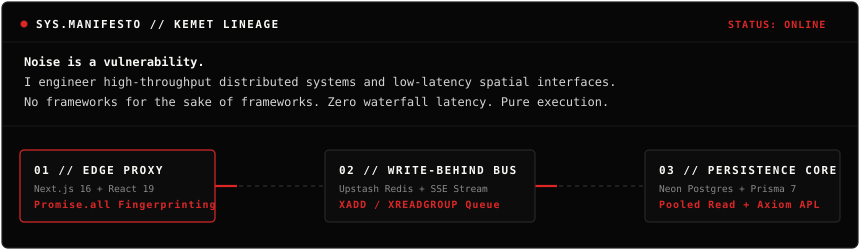

<!-- ANIMATED HERO HEADER -->

<!-- KINETIC TYPING TELEMETRY -->

 

<!-- QUICK COMMAND LINKS -->

&nbsp;

&nbsp;

&nbsp;

 

  

## `01 // ARCHITECTURE & PRODUCTION STACK`

<!-- SKILL ICONS VISUAL BAR -->

  

| Architectural Layer | Production Tooling & Primitives |
| :--- | :--- |
| **Runtime & Core Engine** |  -0a0a0a?style=flat-square&logo=nextdotjs&logoColor=FAF9F6) -0a0a0a?style=flat-square&logo=react&logoColor=61DAFB)  |
| **Data, Cache & Event Streams** |  -0a0a0a?style=flat-square&logo=prisma&logoColor=FAF9F6) -0a0a0a?style=flat-square&logo=redis&logoColor=DC2626)   |
| **Interface, Motion & Client Compute** |      |
| **Transports, Edge & QA** |  -0a0a0a?style=flat-square&logo=socketdotio&logoColor=FAF9F6)  

## `02 // FLAGSHIP SYSTEMS REGISTRY`

<table border="0" cellpadding="0" cellspacing="0" width="100%">
  <tr>
    <td width="50%" valign="top">
      <h3><a href="https://qr.scarabix.org/">01 · Scarabix Inscription Engine</a></h3>
      

        
        
        
        
      

      
Enterprise QR inscription SaaS and high-velocity dynamic edge redirect infrastructure.

      <ul>
        <li><b>Concurrent Edge Proxy:</b> Evaluates IP, MAC/GPU canvas fingerprints (<code>x-machine-id</code>), and maintenance gates via parallel <code>Promise.all</code> before Server Actions execute.</li>
        <li><b>Write-Behind Caching:</b> Buffers mutations in Redis queues (500-item chunks) and diverts scan telemetry into capped Redis Streams (<code>XADD</code> / <code>XREADGROUP</code>) draining to Axiom.</li>
      </ul>
    </td>
    <td width="50%" valign="top">
      <h3><a href="https://flagcal.scarabix.org/">02 · FlagCal — Travel Calendar & World Map</a></h3>
      

        
        
        
        
      

      
Visual calendar that replaces dates with country flags and turns trips into a world map.

      <ul>
        <li><b>Residency Engines:</b> Rolling Schengen 90/180 visa compliance and 183-day tax-residency tracking across contiguous trip periods.</li>
        <li><b>Shareable Travel Passport:</b> Public profiles, follows, and canvas-rendered share images for digital nomads.</li>
      </ul>
    </td>
  </tr>
  <tr>
    <td width="50%" valign="top">
      <h3><a href="https://void.scarabix.org/">03 · VOID — File Drop & Universal Clipboard</a></h3>
      

        
        
        
        
      

      
Personal zero-friction file vault and cross-device clipboard with a native Android client.

      <ul>
        <li><b>Direct-to-Drive Uploads:</b> Resumable browser-to-Google-Drive transfers under the least-privilege <code>drive.file</code> scope, so file bytes never pass through the app server.</li>
        <li><b>Hardened Access:</b> PIN-gated dashboard, HMAC-signed sessions, and fail-closed Upstash rate limiting on Neon + Drizzle.</li>
      </ul>
    </td>
    <td width="50%" valign="top">
      <h3><a href="https://tempo.scarabix.org/">04 · Tempo — Real-Time Bilingual Engine</a></h3>
      

        
        
        
        
      

      
Ultra-low-latency bilingual (Arabic/English) messaging platform engineered for 60fps concurrency.

      <ul>
        <li><b>Sub-16ms Optimistic Dispatch:</b> Pairs React 19 <code>useOptimistic</code> mutations with Upstash Redis rolling windows (<code>LTRIM</code> 50) and Web <code>ReadableStream</code> SSE fan-out.</li>
        <li><b>Keyset Virtualization:</b> Zero-<code>OFFSET</code> cursor pagination over <code>@tanstack/react-virtual</code> with strict Arabic cursive ligature isolation (<code>IBM Plex Sans Arabic</code>).</li>
      </ul>
    </td>
  </tr>
  <tr>
    <td width="50%" valign="top">
      <h3><a href="https://www.renmemoria.com/">05 · Ren Memoria — Archival Luxury Vault</a></h3>
      

        
        
        
        
      

      
High-fashion archival e-commerce terminal and physical artifact inventory vault.

      <ul>
        <li><b>Client-Side Asset Pipeline:</b> Compresses multi-megabyte studio photography in browser Web Workers prior to streaming directly to Vercel Blob storage.</li>
        <li><b>Hybrid Checkout & Clearance Nodes:</b> Combines global Stripe payment sessions with direct WhatsApp order routing across isolated Neon Auth security nodes.</li>
      </ul>
    </td>
    <td width="50%" valign="top">
      <h3><a href="https://scarabix.org/">06 · Scarabix Agency OS & Command ERP</a></h3>
      

        
        
        
        
      

      
Internal multi-project engineering command center, client portal, and financial ledger for Scarabix.

      <ul>
        <li><b>10-Table Relational Core:</b> Orchestrates sprint milestones, staging/production credential vaults, developer time logs, and client lifecycles.</li>
        <li><b>JSONB Mutation Auditing:</b> Deep diffing engine tracking <code>oldValues</code> vs. <code>newValues</code> alongside an arbitrary-precision <code>Decimal(18,2)</code> multi-currency ledger.</li>
      </ul>
    </td>
  </tr>
  <tr>
    <td width="50%" valign="top">
      <h3><a href="https://zerohop.scarabix.org/">07 · ZEROHOP — Client-Side Media Suite</a></h3>
      

        
        
        
        
      

      
Convert, compress, and transform images, video, audio, and PDFs entirely in the browser. Nothing is ever uploaded.

      <ul>
        <li><b>Zero Server Hops:</b> Files never leave the device. Processing runs on WebAssembly engines (<code>wasm-vips</code>, <code>pdf-lib</code>) and GPU WebCodecs, with OPFS-backed storage for large files.</li>
        <li><b>Offline-Ready PWA:</b> One statically exported Next.js app covering HEIC, PDF, DOCX, XLSX, and archive pipelines with instant, 100% private processing.</li>
      </ul>
    </td>
    <td width="50%" valign="top">
      <h3><a href="https://hosnie.scarabix.org/">08 · Editorial Portfolio — hosnie.scarabix.org</a></h3>
      

        
        
        
        
      

      
Brutalist-editorial developer portfolio with a full-screen curtain menu and hand-built SVG card geometry.

      <ul>
        <li><b>Liquid SVG Cards:</b> Project cards are drawn from concentric-arc path math with a notch that wraps the CTA pill, re-measured live with <code>ResizeObserver</code>.</li>
        <li><b>Compositor-Only Motion:</b> Lenis smooth scroll driven by the GSAP ticker, with scroll progress and menu transitions on GPU transforms (<code>scaleX</code> / <code>translate3d</code>) and zero React re-renders.</li>
      </ul>
    </td>
  </tr>
</table>

## `03 // SYSTEM TELEMETRY & COMMIT VELOCITY`

<!-- 1. FIXED LIVE TERMINAL SCANNER (CLEAN ASCII QUERY STRING) -->

<!-- UNIFIED STATS, LANGUAGES & STREAK HUD -->
<table border="0" cellpadding="0" cellspacing="0" width="100%">
  <tr>
    <td width="52%" align="center" valign="middle">
      
    </td>
    <td width="48%" align="center" valign="middle">
      
    </td>
  </tr>
</table>

